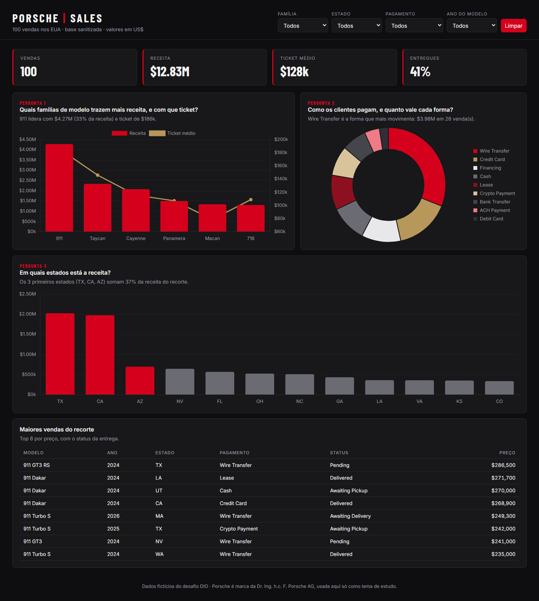
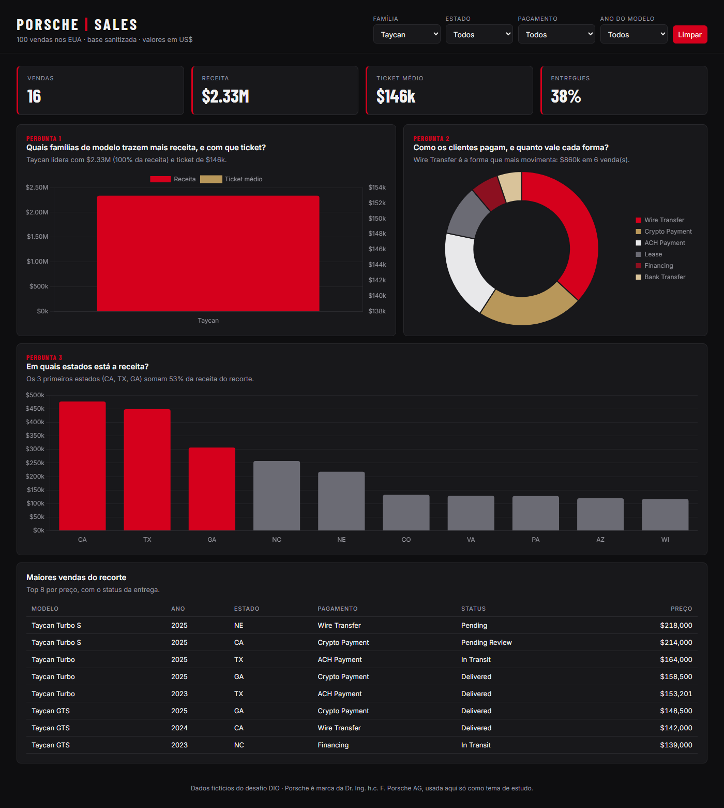

# Dashboard de vendas Porsche em HTML

Dashboard interativa, em um único arquivo HTML, construída a partir de 100 vendas da Porsche nos EUA. Responde três perguntas de negócio, tem filtros combináveis e fica publicada no GitHub Pages.

Projeto do Desafio de Projeto da DIO de dashboard Porsche com IA (trilha Santander Excel 2026).

**Dashboard publicada:** https://hirovieira.github.io/dashboard-porsche-sales/

## Prints

**Visão geral (sem filtro)**



**Filtro aplicado: família = Taycan**



Com o filtro em Taycan: 16 vendas, US$ 2,33M de receita, ticket de US$ 146k (acima da média geral de US$ 128k) e o top 3 de estados muda para CA, TX e GA, que concentram 53% da receita do modelo.

## Perguntas de negócio

| # | Pergunta | Visual | Por que escolhi |
|---|---|---|---|
| 1 | Quais famílias de modelo trazem mais receita, e com que ticket? | Barras (receita) + linha (ticket médio) | Mostra onde está o dinheiro e se ele vem de volume ou de preço. Sem filtro, o 911 lidera com US$ 4,27M (33% da receita) e o maior ticket (US$ 186k). |
| 2 | Como os clientes pagam, e quanto vale cada forma? | Rosca por receita | Ajuda a decidir com quais parceiros financeiros (banco, financeira, leasing) negociar. Wire Transfer lidera com US$ 3,98M em 26 vendas. |
| 3 | Em quais estados está a receita? | Barras por estado, top 3 em destaque | Diz onde concentrar estoque e marketing. TX, CA e AZ somam 37% da receita. |

Indicadores de topo: vendas, receita, ticket médio e % de vendas já entregues. Cada card também tem uma frase de insight que se recalcula com os filtros, e embaixo fica a tabela das 8 maiores vendas do recorte.

**Filtros:** família de modelo, estado, forma de pagamento e ano do modelo, combináveis, com botão "Limpar".

## Tratamento da base

A planilha original (`Sanitized`) traz cada campo em duas versões, a crua e a sanitizada. Antes de ir para a IA:

1. **Fiquei só com as colunas sanitizadas**: data, modelo, ano, preço, km, pagamento, cidade, estado e status.
2. **Converti preço, ano e km para número** (vinham como texto, ex.: `"79500.00"`, `"2022"`).
3. **Removi `customer_name` e `salesperson`**: são nomes de pessoas e não respondem nenhuma das perguntas. Como a base vai embutida no HTML, nada pessoal deveria ir junto.
4. **Criei a coluna `familia`** (911, 718, Cayenne, Macan, Panamera, Taycan) a partir do modelo, porque 40 modelos diferentes em 100 vendas não formam um gráfico legível.
5. **Datas `INVALID`** (24 registros, como `2024-02-30` e `April 31st`) ficaram em branco. Por isso nenhuma pergunta depende da data de venda.

Resultado: [`dados/base_tratada.csv`](dados/base_tratada.csv) e [`dados/vendas.json`](dados/vendas.json), que é o mesmo conteúdo embutido no `index.html`.

## Ferramenta usada e prompt

Usei um **agente de IA com skill de front-end** (Claude Code, no app desktop do Claude), não o ChatGPT com Canvas. O agente recebeu a base tratada e um prompt com as três perguntas, os filtros, os indicadores e a referência visual.

O prompt completo e os refinamentos estão em [`prompt.md`](prompt.md). Resumo do que mudou até a versão final:

- O título deixou de dizer "2024", porque a base tem vendas com data em 2026.
- Recortes sem nenhuma venda passaram a mostrar "Nenhuma venda neste recorte".
- O gráfico de estados ganhou destaque no top 3 e uma frase dizendo quanto ele soma.

Diferença que notei em relação ao que o Expert mostra: com a pergunta de negócio definida antes, a primeira versão já veio utilizável. O trabalho de verdade foi tratar a base e escolher as perguntas.

## Visual

- Referência: identidade da Porsche. Fundo quase preto, cards grafite, vermelho `#d5001c` como destaque e dourado `#b8975a` como cor secundária.
- Tipografia: Barlow Condensed (títulos e números) e Inter (texto).
- Responsivo: no celular os cartões ficam em 2 colunas e os gráficos empilham.

## Como rodar

- Online: abra o link do GitHub Pages acima.
- Local: baixe o repositório e abra o `index.html` no navegador (precisa de internet para carregar o Chart.js e as fontes).

### Publicação no GitHub Pages
Repositório público > **Settings** > **Pages** > *Deploy from a branch* > branch `main`, pasta `/ (root)` > **Save**. Em cerca de um minuto o site fica no ar em `https://<usuario>.github.io/dashboard-porsche-sales/`.

## Estrutura

```
index.html              dashboard (arquivo único, dados embutidos)
dados/base_tratada.csv  base depois do tratamento
dados/vendas.json       mesma base em JSON (a que vai no HTML)
prompt.md               prompt e refinamentos
images/                 prints
```
